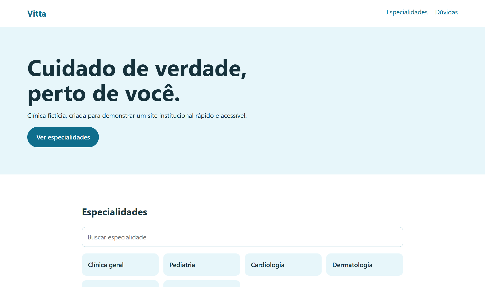
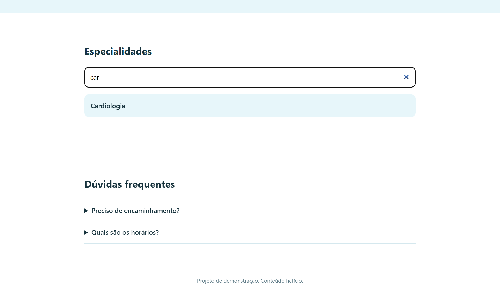

# Site de clínica

Site institucional de uma clínica fictícia, com foco em clareza, acessibilidade e busca rápida de especialidades.

  

**Demonstração:** https://luizrenatodc.github.io/site-clinica/

## Veja funcionando

*Página inicial.*

*Busca de especialidades em tempo real.*

## Objetivo

Quem procura uma clínica quer saber depressa se ela atende o que precisa. O site mostra isso logo de início, com linguagem simples e leitura confortável para qualquer idade.

## O que tem

- Busca instantânea de especialidades, com aviso quando nada é encontrado.
- Perguntas frequentes com `
`, que funcionam sem JavaScript.
- HTML semântico, rótulos acessíveis e alto contraste.
- Dados estruturados `MedicalClinic` em JSON-LD.
- Layout responsivo com CSS Grid.

## Decisões técnicas

| Decisão | Motivo |
| --- | --- |
| Recursos nativos do HTML | Menos código e acessibilidade pronta. |
| Script mínimo | A página continua útil mesmo se o JavaScript falhar. |
| Paleta clara | Transmite cuidado e mantém boa leitura. |

## Como rodar

Abra `index.html` no navegador ou rode `npx serve .`.

## Próximos passos

- Página própria para cada especialidade, para melhorar o SEO.
- Integração com agendamento online.

## Sobre este projeto

Projeto de demonstração, com dados e empresas fictícios, criado para mostrar a abordagem técnica de forma simples.

## Autor

**Luiz Renato Carvalho**, Engenheiro de Software e IA · [luizrenato.dev](https://www.luizrenato.dev) · [LinkedIn](https://linkedin.com/in/luizrenatodc)
